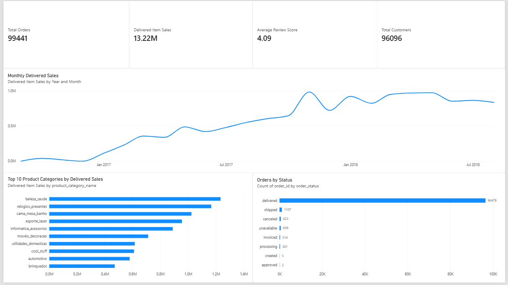
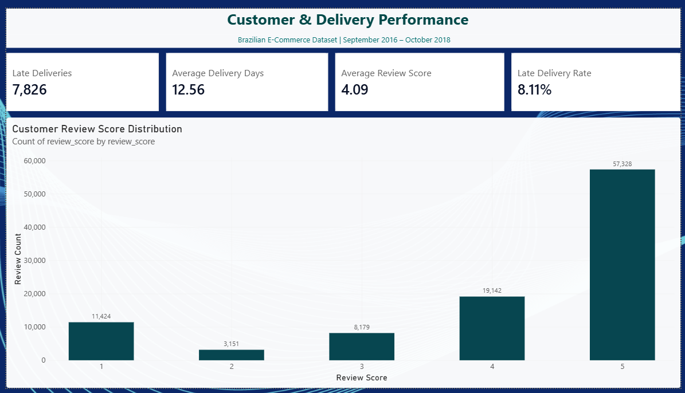

# Brazilian E-Commerce Analytics | Olist

## Project Overview

An end-to-end e-commerce analytics project using the historical Brazilian Olist marketplace dataset. The project transforms raw transactional data into business insights using Python, PostgreSQL, SQL, and Power BI.

The analysis focuses on sales performance, customer behavior, product categories, payment methods, delivery performance, seller performance, and customer reviews.

## Business Questions

- How do delivered item sales change over time?
- Which product categories generate the highest delivered sales?
- What do customer purchasing and repeat-purchase patterns reveal?
- Which payment methods are most commonly used?
- How does delivery performance relate to customer satisfaction?
- How do sellers and product categories perform?

## Tools and Technologies

- **Python:** Data preparation, cleaning, and ETL
- **Pandas:** Data manipulation and validation
- **PostgreSQL:** Relational database and data storage
- **SQL:** Business analysis, aggregations, and KPI calculations
- **Power BI:** Interactive dashboards and reporting
- **DAX:** Measures and KPI calculations

## Project Workflow

1. Inspected and prepared the source datasets using Python and Pandas.
2. Loaded the prepared data into PostgreSQL.
3. Developed 12 SQL scripts to analyse business KPIs and operational performance.
4. Built a two-page Power BI report to communicate key findings through KPIs and visualizations.

## Key Findings

- **99,441** total orders
- **96,096** unique customers
- **R$13.22 million** in delivered item sales
- **4.09 / 5** average customer review score
- **12.56 days** average delivery time
- **8.11%** late-delivery rate among delivered orders

The analysis also identified an association between delivery delays and lower review scores. This is an observed relationship, not proof that delivery delays alone caused lower ratings.

## Dashboard

The Power BI report contains two pages.

### 1. Executive Overview

Highlights order volume, delivered item sales, customer count, monthly sales trends, top product categories, and order status.



[View Executive Overview image](executive_overview.png)

### 2. Customer & Operations

Highlights delivery KPIs and customer review score distribution.



[View Customer & Operations image](customer_operations.png)

## SQL Analysis

The `sql/` directory contains 12 scripts covering:

1. `01_business_overview.sql`
2. `02_revenue_analysis.sql`
3. `03_customer_analytics.sql`
4. `04_product_performance.sql`
5. `05_payment_analysis.sql`
6. `06_review_analysis.sql`
7. `07_delivery_performance.sql`
8. `08_monthly_sales_trend.sql`
9. `09_customer_segments.sql`
10. `10_delivery_review_analysis.sql`
11. `11_seller_performance.sql`
12. `12_executive_kpi_summary.sql`

## Project Structure

```text
ecommerce_customer_analytics/
├── src/
│   └── etl.py
├── raw/                  # Source data, if included locally
├── processed/            # Prepared data, if included locally
├── sql/
│   └── 12 SQL analysis scripts
├── powerbi/
│   └── Olist_Ecommerce_Analytics.pbix
├── executive_overview.png
├── customer_operations.png
└── README.md
```

## How to Reproduce

1. Download the Olist Brazilian E-Commerce dataset from its original source.
2. Place the source CSV files in the location expected by `src/etl.py`.
3. Create a PostgreSQL database named `ecommerce_analytics`.
4. Configure the database connection using your local settings. Do not commit passwords or other credentials to GitHub.
5. Run the ETL script to prepare and load the data.
6. Execute the SQL scripts in the `sql/` directory.
7. Open the Power BI report in `powerbi/` and configure the database connection if required.

## Data Notes and Limitations

- The project uses historical Olist marketplace data from 2016–2018; it is not a live-data dashboard.
- Delivered item sales are calculated from item prices for delivered orders.
- Product costs are unavailable, so profit and profit margin are not calculated.
- The late-delivery rate is calculated among delivered orders with the delivery outcome classified as early or late; orders with missing actual delivery dates are treated as unknown.
- Delivery performance compares actual delivery dates with estimated delivery dates.
- The relationship between delivery timing and review scores should be interpreted as an association, not causation.

## Author

Created as an analytics portfolio project demonstrating Python-based ETL, PostgreSQL data handling, SQL analysis, and Power BI reporting.
